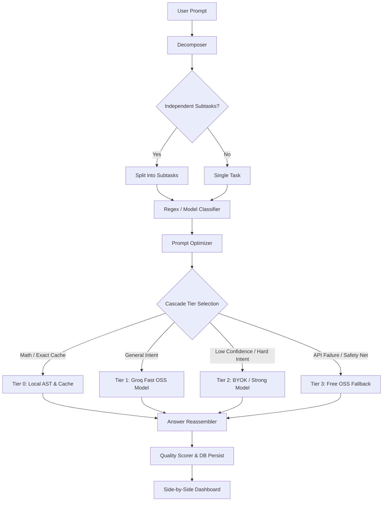

# Kifayat — LLM Token & Cost Optimization Engine

> **"Kifayat"** (Hindi/Urdu: kifāyat — thrift, economy, efficiency)

Kifayat is an open-source, self-hosted proxy engine and dashboard designed to reduce LLM API token consumption and costs without compromising response quality. It sits between your prompt and the LLM provider, dynamically compressing inputs, enforcing structured output caps, and routing queries through a confidence-gated 4-tier cascade.

---

## Key Performance Highlights

| Metric | Measured Benchmark Value | Description |
| :--- | :---: | :--- |
| **Avg Cost Savings** | **`73.18%`** | Direct reduction in API costs compared to naive strong-model calls |
| **Avg Token Reduction** | **`44.24%`** | Input & output token savings through filler stripping and output caps |
| **Quality Preservation** | **`88.08%`** | Cosine similarity of dense text embeddings (`all-MiniLM-L6-v2`) vs unoptimized baseline |
| **Tier 0 Hits (Zero-Cost)** | **`16.7%`** | Arithmetic and exact-match queries resolved locally in 0 ms at $0 cost |

---

## 4-Tier Cascade Architecture

Kifayat routes incoming prompts through a multi-stage optimization pipeline to minimize cost and latency:



### Cascade Tiers Breakdown

- **Tier 0 — Free Local Heuristics (0 ms, $0 cost)**
  - Safe AST arithmetic evaluation using `mathjs` (e.g. `sqrt(2025)`, `15% of 240`, `847 * 23`).
  - Exact-match prompt caching (in-memory, TTL-managed).

- **Tier 1 — Cheap Hosted OSS Model (~350 ms)**
  - Fast, low-cost model execution via Groq (`openai/gpt-oss-20b`).
  - Confidence-gated: Escalates to Tier 2 if routing confidence score falls below `0.65`.

- **Tier 2 — Strong Model / BYOK (~1.2 s)**
  - Stronger model path (`gpt-4o-mini` or `gpt-4o`) via Bring-Your-Own-Key (BYOK) injected per-request or server-side pooled key.
  - Automatically invoked for hard intents (`code`, `complex reasoning`) or low Tier 1 confidence.

- **Tier 3 — Free OSS Safety Net Fallback**
  - Always-on fallback to ensure zero runtime downtime even during API provider outages.

---

## Benchmark Evaluation Results

Evaluated across an 18-prompt benchmark suite (`npm run eval`) spanning math, code, sentiment, summarization, factual Q&A, logical reasoning, creative writing, and compound tasks:

| Category | Tier 0 Hit % | Quality Preservation | Avg Token Savings | Notes |
| :--- | :---: | :---: | :---: | :--- |
| **Math** | 100% | **100.0%** | **100.0%** | Resolved locally in Tier 0 via AST evaluation |
| **Sentiment** | 0% | **100.0%** | **37.4%** | Enforced 1-word output constraint |
| **Factual** | 0% | **89.5%** | **36.8%** | Direct answers, preambles stripped |
| **Compound** | 0% | **85.8%** | **40.5%** | Decomposed into subtasks & reassembled |
| **General Q&A** | 0% | **85.4%** | **36.0%** | Input filler stripped, concise response |
| **Summarization** | 0% | **85.2%** | **38.8%** | Bullet-point structured caps applied |
| **Creative** | 0% | **84.5%** | **22.0%** | Preambles stripped, direct creative output |
| **Reasoning** | 0% | **81.3%** | **16.4%** | Hard intent escalated to Tier 3 fallback |
| **Code** | 0% | **74.8%** | **51.2%** | Strict code fence output, comments trimmed |

---

## Quick Start Guide

### Prerequisites
- **Node.js**: v18.0.0 or higher
- **Groq API Key**: Free API key from [console.groq.com](https://console.groq.com)

### 1. Clone & Install

```bash
git clone https://github.com/infinitepush/Kifayat.git
cd Kifayat
npm install
```

### 2. Configure Environment

Create a `.env.local` file at the root directory:

```bash
cp .env.local.example .env.local
```

Edit `.env.local` and add your Groq API key:

```env
GROQ_API_KEY=gsk_your_groq_api_key_here
DATABASE_URL="file:./dev.db"
```

### 3. Initialize SQLite Database

```bash
npx prisma migrate dev --name init
```

### 4. Run Development Server

```bash
npm run dev
```

Open [http://localhost:3000](http://localhost:3000) in your browser to access the dashboard.

### 5. Run Benchmark Evaluation

```bash
npm run eval
```

This runs all 18 benchmark prompts with rate-limit pacing and exports a detailed analysis to `benchmark-results.json`.

---

## API Documentation

### `POST /api/compare`
Runs a prompt through both the **naive baseline** (direct call) and the **Kifayat optimized pipeline** in parallel. Returns side-by-side cost, token, latency, and quality preservation metrics.

#### Request Body
```json
{
  "prompt": "Summarize the key benefits of web performance optimization in 3 bullet points."
}
```

#### Optional Headers (BYOK)
```http
x-byok-key: sk-proj-...
x-byok-provider: openai
```

#### Response Example
```json
{
  "naive": {
    "answer": "Web performance optimization offers several crucial benefits...",
    "tokensIn": 82,
    "tokensOut": 412,
    "costUsd": 0.000255,
    "latencyMs": 1420
  },
  "optimized": {
    "answer": "- Fast load times improve user engagement.\n- Higher search engine ranking.\n- Reduced bandwidth cost.",
    "tokensIn": 65,
    "tokensOut": 48,
    "costUsd": 0.000018,
    "latencyMs": 380,
    "tierUsed": 1,
    "intentCategory": "summarization"
  },
  "qualityPreservation": 0.8808,
  "tokenSavingsPct": 44.24,
  "costSavingsPct": 73.18
}
```

---

### `POST /api/optimize`
Runs the optimized pipeline directly and returns the final answer.

---

### `GET /api/runs?limit=20`
Fetches historical runs stored in the SQLite database with aggregate statistics.

---

## Tech Stack

- **Framework**: Next.js 16 (App Router) + React 19 + TypeScript
- **Styling**: Vanilla CSS Variables (Dark theme, glassmorphism, responsive design)
- **Database**: SQLite with Prisma ORM
- **LLM Integrations**: OpenAI SDK + Groq API
- **Embeddings & Quality Scoring**: `@xenova/transformers` (`all-MiniLM-L6-v2` dense embeddings running locally)
- **Arithmetic Engine**: `mathjs` AST evaluator

---

## License & Attribution

Distributed under the MIT License.
